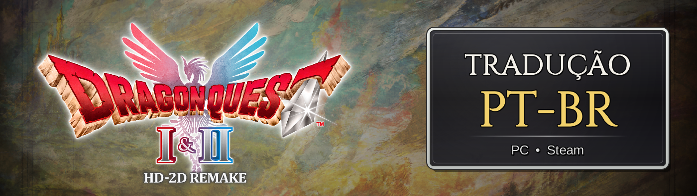
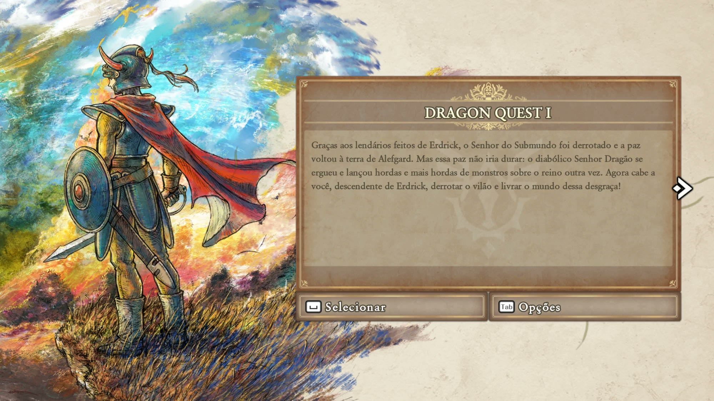
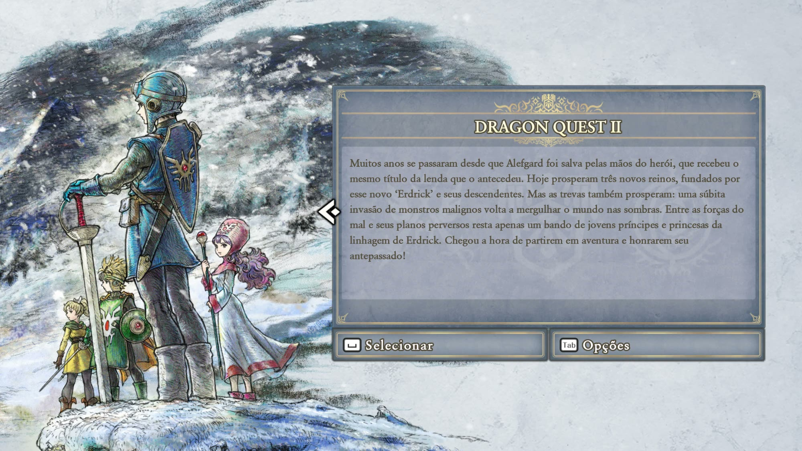
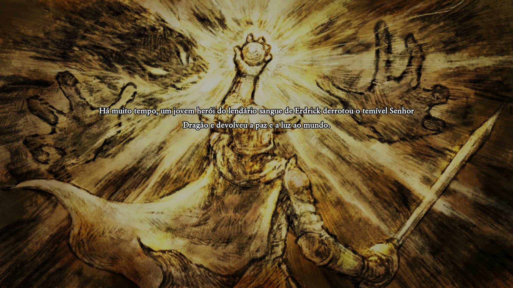
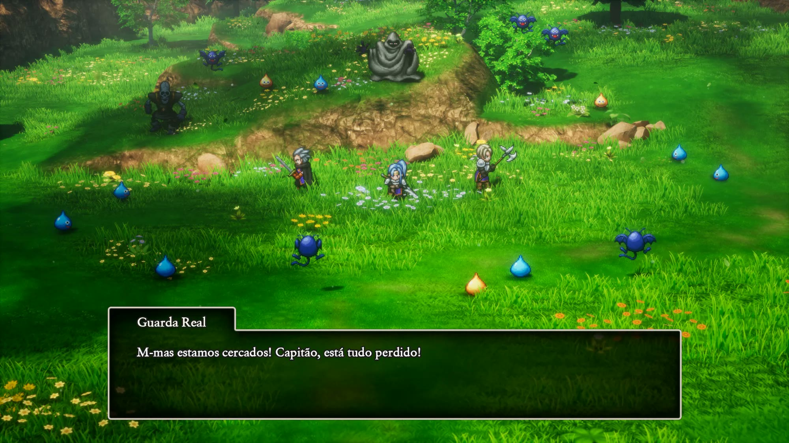

# 🐉 Dragon Quest I & II HD-2D Remake (PC) — Tradução PT-BR

-009c3b)

Tradução de fã do **Dragon Quest I & II HD-2D Remake** (PC, Steam).
**Tradução completa para o português do Brasil** dos dois jogos, com menus, história, diálogos, magias, itens,
monstros, lugares e descrições em português.

*Feita por fãs, para fãs. Gratuita, sem fins lucrativos e sem nenhuma ligação com a Square Enix (veja o aviso legal no
fim desta página).*

> ✅ Os dois jogos estão traduzidos por inteiro. Se achar algum problema, abra uma [issue](../../issues).

## 📸 Fotos

| | |
|---|---|
|  |  |
| Tela de título | Dragon Quest I: escolha do jogo |
|  |  |
| Dragon Quest II: escolha do jogo | Dragon Quest I: menu de campo |
|  |  |
| Dragon Quest II: abertura | Dragon Quest II: diálogo da história |
|  | |
| Dragon Quest II: batalha | |

## 📥 Download

**[⬇️ Baixar a tradução](../../releases/latest)** (página da versão mais recente). Dentro do zip vem o arquivo `.pak` da
tradução e um guia `LEIA-ME.txt`. Como instalar: veja **💾 Instalação** abaixo.

## 🎮 O que foi traduzido

| Parte | Textos | Cobertura |
|---|---|---|
| Diálogos, cenas, moradores, livros e placas (DQ I e DQ II) | 12.201 | 100% |
| Menus, itens, magias, habilidades, monstros, batalha, lojas, igreja, guia do mapa, Dicas de Viagem | 3.490 | 100% |
| Nomes com gênero, artigo e plural (itens, monstros, magias, lugares, personagens) | 1.584 | 100% |

- **Tudo a partir do inglês**, com o contexto da história e de quem está falando em cada fala. Quando o inglês faz
  piada ou rima, a piada e a rima foram recriadas em português em vez de traduzidas ao pé da letra.
- **"Você" com sabor antigo:** o inglês do jogo é todo arcaico (*thou, thee, hast*). Em vez de "tu" e "vós", o ar
  medieval vem do vocabulário e da ordem das frases (*"Saudações"*, *"imploro-lhe"*), com reis e anciãos mais solenes.
- **Cada personagem fala do seu jeito:** o ceceio da princesa de Aliahan, a fala popular dos piratas, anões e
  brutamontes, as fadas (*Super-Visora, Sussurra-Sonhos, Mestra-Artesã*), a quadrilha do **Roubin' Hood** e os slimes
  que falam "gosma" (*"gosmaravilhoso"*).
- **Interface:** PV/PM no lugar de HP/MP, artigos e gênero corretos nas mensagens de batalha (*"O prestidigitador sofre
  302 pontos de dano!"*, *"A múmia está confusa!"*) e "O" de ouro no lugar do "G" das moedas.

### Alguns exemplos

- **Magias:** *Frizz/Kafrizz → Fogo/Megafogo · Zap/Kazap → Raio/Megarraio · Zoom → Teleporte*. As magias seguem o
  mesmo padrão das nossas traduções do Dragon Quest VIII e IX (base, Super, Mega, Giga), para dar para ver a força da
  magia só pelo nome.
- **Itens:** *Medicinal Herb → Erva Medicinal · Chimaera Wing → Asa de Quimera · Sun Sigil → Selo do Sol ·
  Malevolash → Malaçoite · Hextract → Extrato de Bruxa*.
- **Monstros:** traduzidos, com graça (*Dracky → Draculino · Madusa → Doidusa · Hula Ruler → Rei do Rebolado ·
  Drohl Drone → Babão Operário*); Slime, Golem e Orc ficam, porque já são palavras do português.
- **Cidades:** os nomes próprios ficam (Midenhall, Moonbrooke, Cannock, Tantegel); as que são piada ou descrição foram
  recriadas (*Rippleport → Porto Marola · Leftwyne → Vila Poente*).
- **Dificuldades:** *Missão Draculino*, *Missão Dragão* e *Missão Draconiana*.

## 🚫 O que não foi traduzido (de propósito)

| O quê | Por quê |
|---|---|
| Nomes próprios (Erdrick, Alefgard, Gwaelin, Midenhall, Cannock, Moonbrooke, Hargon…) | São nomes, iguais em todas as versões do jogo. |
| Imagens das Dicas de Viagem e do tutorial (telas de exemplo do menu) | São capturas da tela em inglês; o texto das dicas em si está traduzido. |
| Logotipos | Arte e marcas registradas. |
| Créditos finais (cargos e nomes da equipe) | Ficam como no original. |
| Puff-Puff | Piada clássica da série; o nome é o mesmo em todas as línguas. |
| Slime, Golem e Orc | Nomes de monstros que já são palavras usadas em português. |
| Nome do idioma no menu ("Inglês") | A lista de idiomas é fixa no jogo: a tradução entra no lugar do inglês. |
| Separador de milhar com vírgula (*758,761*) | Vem do motor do jogo com o idioma inglês. |
| Vozes | Ficam as vozes originais (inglês ou japonês, como você escolher). |

## 💿 O que você precisa

Você precisa da sua **própria cópia** do **Dragon Quest I & II HD-2D Remake** para **PC (Steam)**. **Este projeto não
distribui o jogo.**

## 💾 Instalação

A tradução é um arquivo `.pak` que o jogo carrega **por cima** dos arquivos originais. Nenhum arquivo do jogo é
alterado.

1. Copie o arquivo `DQ1_2_PTBR_P.pak` para a pasta `Paks` do jogo:
   `...\steamapps\common\DRAGON QUEST I and II HD-2D Remake\Game\Content\Paks\`
   (na Steam: botão direito no jogo → *Gerenciar* → *Explorar arquivos locais* → `Game\Content\Paks`).
2. Abra o jogo e, em *Opções de Idioma*, deixe o **Idioma do Texto** em **Inglês** (*English*). As vozes podem ficar
   no idioma que preferir.

- **Para atualizar** a partir de qualquer versão anterior, apague da pasta `Paks` o `.pak` antigo da tradução
  (qualquer arquivo `DQ1_2_PTBR_..._P.pak`) e copie o novo. **Para voltar ao inglês**, só apague o `.pak`.
- **Outras traduções:** se houver outro `.pak` de tradução na pasta `Paks` (de outra equipe), tire-o antes; com dois,
  o jogo mistura os textos.

Saves do jogo em inglês funcionam normalmente.

## 🔒 Segurança

- Baixe a tradução **só pela página de [Releases](../../releases) deste repositório**.
- A tradução é só o arquivo `.pak` com os textos: **não há executável** nem instalador.

## ❓ Não funcionou?

| Sintoma | Causa provável |
|---|---|
| Continua tudo em inglês | O `.pak` não está em `Game\Content\Paks`, ou o Idioma do Texto não está em *Inglês* (*English*). |
| Textos misturados ou nomes antigos | Há outro `.pak` de tradução na pasta `Paks` (de outra equipe ou de uma versão anterior desta). Deixe só o novo. |
| Algo em inglês depois de uma atualização do jogo | A atualização pode ter mudado os textos. Abra uma issue. |
| Travamento ou tela preta | Abra uma issue informando onde aconteceu. |

## 🐞 Achou um erro?

Abra uma [issue](../../issues/new/choose) usando o formulário "Erro na tradução". Informe a versão do patch, o jogo
(DQ I ou DQ II), o lugar e, se puder, mande um print. Toda correção de português também é bem-vinda.

## 🙏 Créditos

- **Tradução, revisão e ferramentas:** [0xdhx0](https://github.com/0xdhx0).
- **Fontes livres** usadas no banner: Cinzel e Arimo (licença OFL).

**Como foi feita:** a tradução usou ferramentas de IA. Todo o texto foi traduzido a partir do inglês com o contexto da
história e o jeito de falar de cada personagem, e testado no jogo. Se achar uma frase estranha, abra uma
[issue](../../issues), porque toda sugestão ajuda.

## ⚖️ Aviso legal e uso

- Esta é uma **tradução feita por fãs, para fãs**, **gratuita** e **sem fins lucrativos**.
- **Não temos nenhuma ligação** com a Square Enix ou qualquer outra empresa envolvida no jogo. O projeto não é oficial,
  nem aprovado ou apoiado por elas.
- *Dragon Quest I & II HD-2D Remake* e todos os nomes, marcas e personagens pertencem aos seus donos
  (© ARMOR PROJECT/BIRD STUDIO/SPIKE CHUNSOFT/SQUARE ENIX, © SUGIYAMA KOBO).
- O pacote contém **só os arquivos de texto da tradução** (um `.pak`) e **não funciona sem o jogo original**. O jogo
  não é distribuído aqui: não peça nem compartilhe cópias do jogo neste repositório.
- Pode usar e compartilhar a tradução à vontade, **de graça**. Ela **não pode ser vendida** nem monetizada. Se alguém
  cobrou por ela, você foi enganado. Veja [LICENSE.txt](LICENSE.txt).
- Se você é detentor de algum direito e quer que algo seja retirado, abra uma issue ou entre em contato pelo GitHub.

Apoie a franquia comprando os jogos oficiais.
