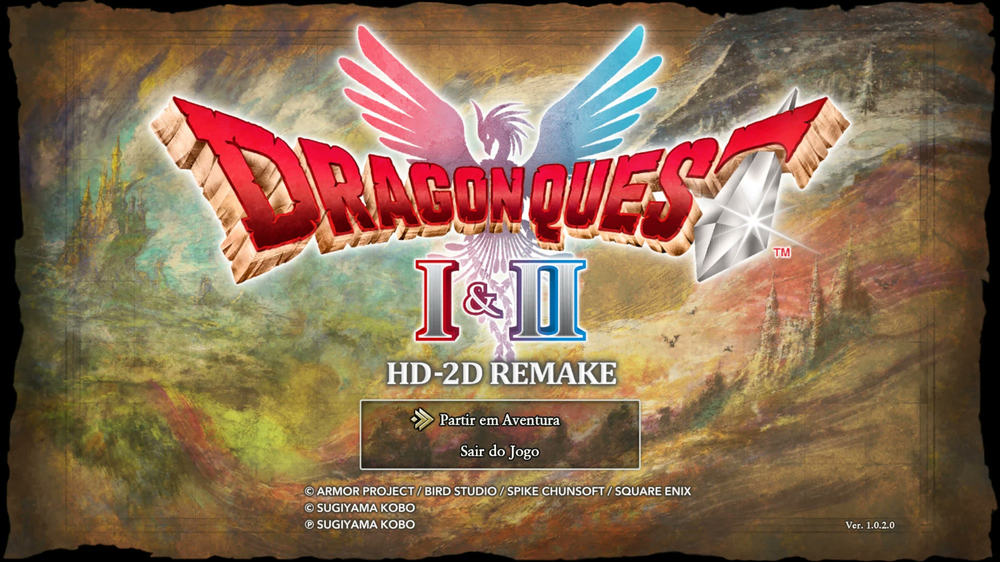
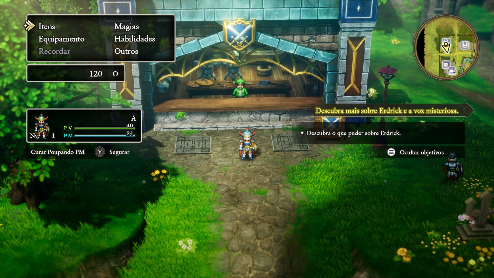
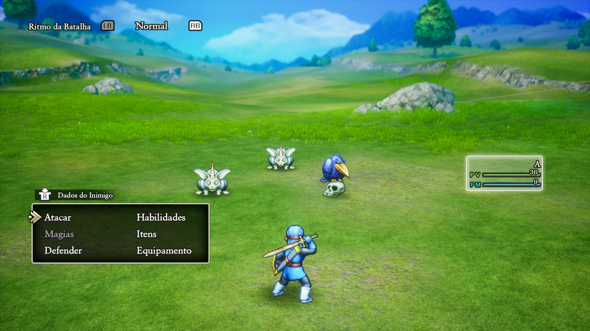

# 🐉 Dragon Quest I & II HD-2D Remake (PC) — Tradução PT-BR v1.0

-009c3b)
-1b2838)

Tradução de fã do **Dragon Quest I & II HD-2D Remake** (PC, Steam) para o **português do Brasil**.

*Feita por fãs, para fãs. Gratuita, sem fins lucrativos e sem nenhuma ligação com a Square Enix (veja o aviso legal no
fim desta página).*

> ✅ Os dois jogos estão traduzidos por inteiro: história, falas de todas as cidades e castelos, menus, itens, magias,
> habilidades, monstros, descrições, mensagens de batalha, guia do mapa, Dicas de Viagem e os cargos dos créditos.
> Se achar algum problema, abra uma [issue](../../issues).

> 🇯🇵 **Traduzida com duas visões do texto desde o começo**: o inglês como base (sentido, piadas, rimas e sotaques da
> localização) e o **japonês original** para acertar gênero e plural, quem fala com quem e o que o inglês deixa ambíguo.

## 📸 Fotos

<table>
<tr>
<td align="center"> Tela de título</td>
<td align="center"> Dragon Quest I: escolha do jogo</td>
</tr>
<tr>
<td align="center"> Dragon Quest II: escolha do jogo</td>
<td align="center"> Dragon Quest I: menu de campo</td>
</tr>
<tr>
<td align="center"> Dragon Quest II: abertura</td>
<td align="center"> Dragon Quest II: diálogo da história</td>
</tr>
<tr>
<td align="center" colspan="2"> Dragon Quest II: batalha</td>
</tr>
</table>

## 📥 Download (v1.0)

**[⬇️ Baixar `DQ12_HD2D_PTBR_v1.0.zip`](../../releases/latest)**: as duas versões da tradução, o guia `LEIA-ME.txt` e os
termos de uso.

| Dentro do zip | O que é |
|---|---|
| `Nomes Traduzidos/DQ1_2_PTBR_NomesTraduzidos_P.pak` | Versão Nomes Traduzidos (tudo em português) |
| `Nomes Originais/DQ1_2_PTBR_NomesOriginais_P.pak` | Versão Nomes Originais (igual, mas com os nomes que se procuram num guia como no original) |

## 🎭 Duas versões: escolha a sua

| | **Nomes Traduzidos** | **Nomes Originais** |
|---|---|---|
| Menus e telas | Português | Português |
| História, diálogos e mensagens | Português | Português |
| Descrições de itens, magias, habilidades e monstros | Português | Português |
| Piadas, rimas e sotaques dentro das falas | Recriados em português | Recriados em português |
| Magias e habilidades | Português (*Fogo, Megafogo, Raio, Megarraio, Teleporte*) | Originais (*Frizz, Kafrizz, Zap, Kazap, Zoom*) |
| Itens e equipamentos | Português (*Erva Medicinal, Asa de Quimera, Espada de Erdrick, Selo do Sol*) | Originais (*Medicinal Herb, Chimaera Wing, Erdrick's Sword, Sun Sigil*) |
| Monstros, inclusive chefes | Português (*Draculino, Slime Metálico, Golem de Ouro*) | Originais (*Dracky, Metal Slime, Gold Golem*) |
| Cidades, castelos e masmorras | Português (*Porto Marola, Castelo do Senhor Dragão, Covil de Hargon*) | Originais (*Rippleport, Dragonlord's Castle, Hargon's Lair*) |
| Pousadas, lojas e lugares só citados | Português | Português (iguais) |
| Apelidos-trocadilho de personagem | Português (*Roge Mão-Leve, Dom Percal, Seu Ronrom*) | Originais (*Roge Fastfinger, Don Calico, Mister Purrkins*) |
| Títulos com nome (o título se traduz, o nome não) | Português (*Rei de Tantegel, Princesa Gwaelin, Senhor Dragão*) | Português (iguais) |
| Nomes próprios sem trocadilho (Erdrick, Alefgard, Midenhall, Cannock, Moonbrooke, Hargon…) | Iguais | Iguais |
| PV / PM / Nv. | PV / PM / Nv. | PV / PM / Nv. |

- **Nomes Traduzidos:** o jogo todo em português, com os trocadilhos dos nomes recriados.
- **Nomes Originais:** para quem joga com guia, wiki ou fórum em inglês. É igual à Nomes Traduzidos, menos o que se
  procura num guia: os nomes de **cidades e masmorras, itens, equipamentos, magias, habilidades e monstros** ficam como
  no original. Todo o resto continua em português. Exemplo: na batalha a magia aparece como *Kafrizz* e o monstro como
  *Metal Slime*, mas toda a frase em volta continua em português.

## ✨ Destaques da tradução

- **"Você" com sabor antigo:** o inglês do jogo é todo em estilo arcaico (*thou, thee, hast*). Em vez de "tu" e "vós",
  o ar medieval vem do vocabulário e da ordem das frases (*"Saudações"*, *"imploro-lhe"*), com reis e anciãos mais
  solenes.
- **Artigos e gênero de verdade na batalha:** *"O prestidigitador sofre 302 pontos de dano!"*, *"A múmia está
  confusa!"*. Cada nome tem gênero, artigo e plural em português.
- **Vozes:** rimas recriadas rimando, o ceceio da princesa de Aliahan, a fala popular dos piratas e anões, as fadas
  (*Super-Visora, Sussurra-Sonhos, Mestra-Artesã*), a quadrilha do **Roubin' Hood** e os slimes que falam "gosma"
  (*"gosmaravilhoso"*).
- **Magias por nível:** base < Super < Mega < Giga (*Raio, Super-raio, Megarraio, Gigarraio*), o mesmo padrão das nossas
  traduções do Dragon Quest VIII e IX.
- **Dificuldades:** *Draculino Quest*, *Dragon Quest* e *Draconiano Quest*.

## 🚫 O que não foi traduzido (de propósito)

| O quê | Por quê |
|---|---|
| Imagens das Dicas de Viagem (telas de exemplo do menu) | São capturas da tela em inglês; o texto das dicas em si está traduzido. |
| Logotipos e os cargos grandes do final (*Scenario & Game Design*…) | Arte e marcas; os créditos em texto estão traduzidos. |
| Nomes da equipe, empresas e avisos legais nos créditos | Nomes próprios e textos legais (iguais em todos os idiomas do jogo). |
| Separador de milhar com vírgula (*758,761*) | Vem do motor do jogo com o idioma inglês. |

## 💿 O que você precisa

- O **Dragon Quest I & II HD-2D Remake** original para **PC (Steam)**. **Este projeto não distribui o jogo.**
- O idioma do texto em **inglês** nas opções (a tradução entra no lugar do inglês; com ela instalada, a opção aparece como *Inglês*).

## 💾 Como instalar

A tradução é um arquivo `.pak` que o jogo carrega **por cima** dos arquivos originais. Nenhum arquivo do jogo é
alterado.

1. Escolha **uma** versão (Nomes Traduzidos **ou** Nomes Originais).
2. Copie o `.pak` dela para a pasta `Paks` do jogo:
   `...\steamapps\common\DRAGON QUEST I and II HD-2D Remake\Game\Content\Paks\`
   (na Steam: botão direito no jogo → *Gerenciar* → *Explorar arquivos locais* → `Game\Content\Paks`).
3. Abra o jogo e, em *Opções de Idioma*, deixe o **Idioma do Texto** em **Inglês** (*English*). As vozes podem ficar no idioma que preferir.

- **Desinstalar:** apague o `.pak` da tradução da pasta `Paks`.
- **Trocar de versão:** apague um `.pak` e copie o outro. **Nunca deixe os dois** na pasta ao mesmo tempo.
- **Outras traduções:** se houver outro `.pak` de tradução na pasta `Paks` (de outra equipe), tire-o antes; com dois,
  o jogo mistura os textos.
- **Saves** do jogo em inglês funcionam normalmente com a tradução.
- **Atualizações do jogo** podem mudar os textos; se algo aparecer em inglês depois de uma atualização, abra uma issue.

## 🔒 Segurança

- Baixe a tradução **só pela página de [Releases](../../releases) deste repositório**.
- A tradução é só o arquivo `.pak` com os textos: **não há executável** nem instalador.

## ❓ Não funcionou?

| Sintoma | Causa provável |
|---|---|
| Tudo continua em inglês | O `.pak` não está em `Game\Content\Paks`, ou o Idioma do Texto não está em *Inglês* (*English*). |
| Textos misturados (parte em outra tradução) | Há outro `.pak` de tradução na pasta `Paks`. Deixe só o nosso. |
| Nomes trocados entre as versões | Os dois `.pak` (Nomes Traduzidos e Nomes Originais) estão na pasta. Deixe só um. |
| Travamento ou tela preta | Abra uma issue informando onde aconteceu. |

## 🐞 Achou um erro?

Abra uma [issue](../../issues/new/choose) usando o formulário "Erro na tradução". Informe a versão (Nomes Traduzidos ou
Nomes Originais), o jogo (DQ I ou DQ II), o lugar e, se puder, mande um print. Toda correção de português também é
bem-vinda.

## 🙏 Créditos

- **Tradução, revisão e ferramentas:** [0xdhx0](https://github.com/0xdhx0).
- **Fontes livres** usadas no banner: Cinzel e Arimo (licença OFL).

**Como foi feita:** a tradução usou ferramentas de IA, com revisão. Todo o texto foi traduzido a partir do inglês e do
japonês, com o contexto da história e o jeito de falar de cada personagem, e testado no jogo. Se achar uma frase
estranha, abra uma [issue](../../issues), porque toda sugestão ajuda.

## ⚖️ Aviso legal e uso

- Esta é uma **tradução feita por fãs, para fãs**, **gratuita** e **sem fins lucrativos**.
- **Não temos nenhuma ligação** com a Square Enix ou qualquer outra empresa envolvida no jogo. O projeto não é oficial,
  nem aprovado ou apoiado por elas.
- *Dragon Quest I & II HD-2D Remake* e todos os nomes, marcas e personagens pertencem aos seus donos
  (© ARMOR PROJECT/BIRD STUDIO/SPIKE CHUNSOFT/SQUARE ENIX, © SUGIYAMA KOBO).
- O pacote contém **só os arquivos de texto da tradução** e **não funciona sem o jogo original**. O jogo não é
  distribuído aqui: não peça nem compartilhe cópias do jogo neste repositório.
- Pode usar e compartilhar a tradução à vontade, **de graça**. Ela **não pode ser vendida** nem monetizada. Se alguém
  cobrou por ela, você foi enganado. Veja [LICENSE.txt](LICENSE.txt).
- Se você é detentor de algum direito e quer que algo seja retirado, abra uma issue ou entre em contato pelo GitHub.

Apoie a franquia comprando os jogos oficiais.
